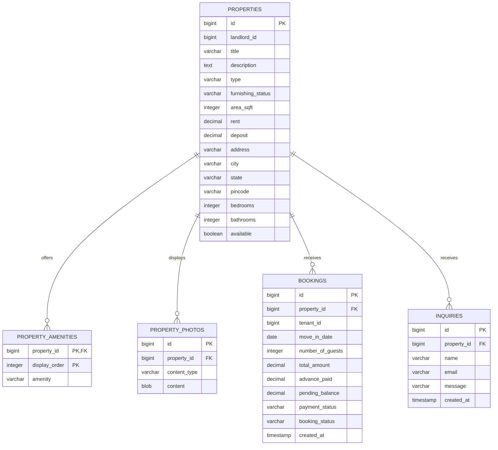

# Rental Listing Database Design

## ER diagram

`landlord_id` and `tenant_id` identify users managed outside this service; this application does not currently persist user accounts or authentication. The property references in bookings, inquiries, photos, and amenities are database foreign keys.

## Tables and constraints

| Table | Purpose and key relationships |
|---|---|
| `properties` | Rental listing details. `id` is the primary key; `rent` is the monthly rent and `deposit` is the security deposit. |
| `property_amenities` | Ordered amenity names, keyed by (`property_id`, `display_order`). `property_id` references `properties.id`. |
| `property_photos` | One row per image, allowing up to five photos per property. `property_id` references `properties.id`; image bytes and MIME type are stored for retrieval through the photo API. |
| `bookings` | One booking request for a property and tenant identity. `property_id` references `properties.id`. `pending_balance` is calculated as `total_amount - advance_paid`; payment status is `PENDING`, `PARTIAL`, or `PAID`. |
| `inquiries` | Contact inquiries about a listing. `property_id` references `properties.id`; records include the sender, message, and creation time. |

Booking amounts use decimal precision to represent currency accurately. The service validates that the advance is non-negative and no greater than the total, calculates the remaining balance, and derives payment status. Payment recording rejects zero/negative and over-balance amounts. Booking lifecycle values are `REQUESTED`, `CONFIRMED`, `CANCELLED`, or `COMPLETED`.

## API surface

| Flow | Endpoints |
|---|---|
| Listings | `GET/POST /api/properties`, `GET/PUT/DELETE /api/properties/{id}`, `GET /api/properties/search` |
| Listing images | `POST /api/properties` with `property` and optional `photos` parts; `GET/POST /api/properties/{propertyId}/photos`; `GET/DELETE /api/properties/{propertyId}/photos/{photoId}` |
| Bookings and payments | `GET/POST /api/bookings`, `GET/DELETE /api/bookings/{id}`, `GET /api/bookings/property/{propertyId}`, `GET /api/bookings/tenant/{tenantId}`, `PATCH /api/bookings/{id}/payment`, `PATCH /api/bookings/{id}/status` |
| Inquiries | `GET/POST /api/inquiries`, `GET/DELETE /api/inquiries/{id}`, `GET /api/inquiries/property/{propertyId}` |

Controllers handle HTTP request/response concerns; the corresponding services enforce validation and business rules; Spring Data repositories persist the entities.
